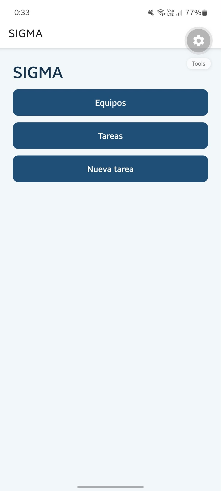
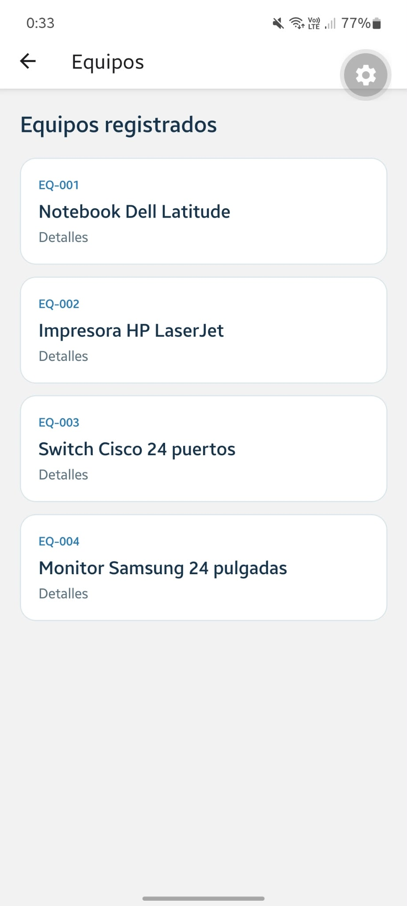
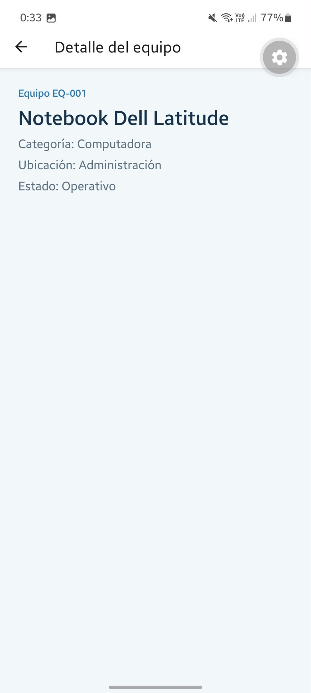
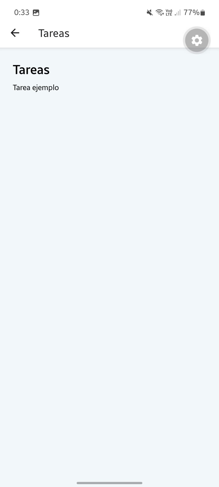
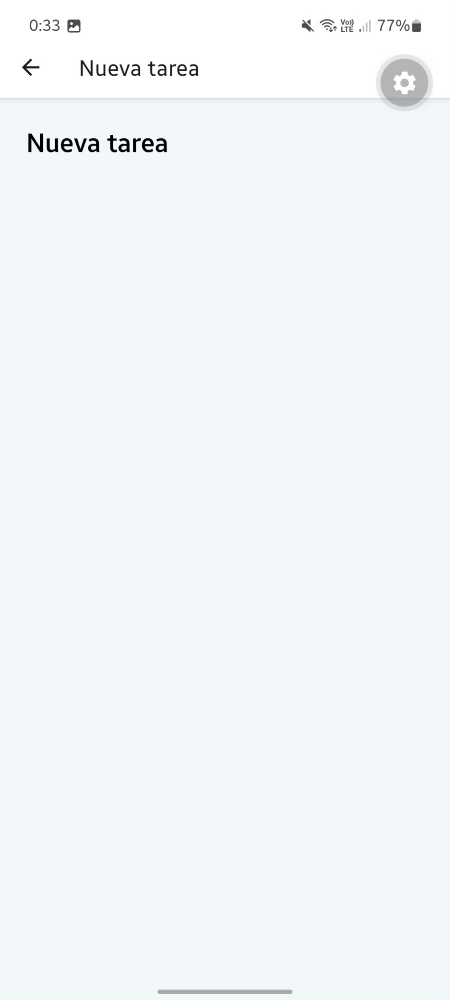

# SIGMA

- Proyecto creado apoyado de los ejemplos y materiales vistos en clase.

- Estilos y datos de prueba generados con IA.

## Explicacion

- Inicio: tres botones que son Link con asChild y dentro tienen un Pressable.

- Equipos: muestra la lista de equipos precargada con FlatList. Cada equipo es un Link hacia su detalle usando la ruta dinamica /equipo/id.

- Tareas y nueva tarea: por ahora paginas vacias.

## Capturas

### Inicio

### Equipos

### Detalle de un equipo (ruta dinámica)

### Tareas

### Nueva tarea
